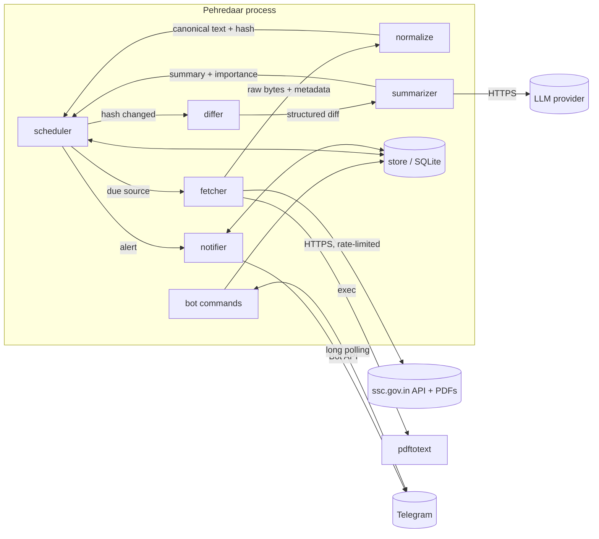
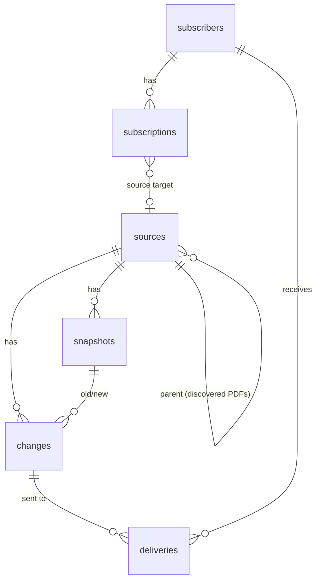
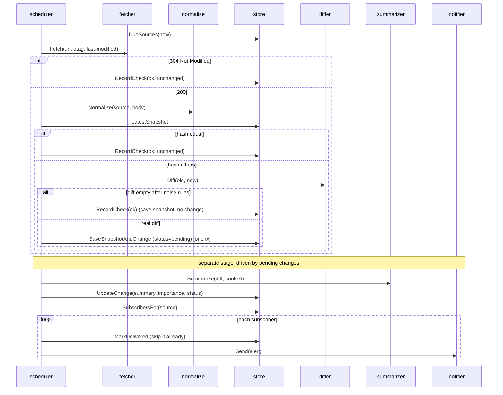

# Pehredaar Architecture

Status: **proposal** (v1 / SSC MVP). Nothing here is implemented yet.
Read alongside [`CLAUDE.md`](../CLAUDE.md), which holds the product brief.

---

## 1. Goals and non-goals

**Goals (v1)**

- Detect meaningful edits to a curated set of SSC notices and PDFs, and new
  notices (e.g. a corrigendum) appearing in SSC feeds.
- Tell subscribers *what* changed in one or two plain sentences, on Telegram.
- Never alert on cosmetic noise. A false alert costs more trust than a late one.
- Be a polite client: few requests, clear identity, back off when a site struggles.
- Survive restarts and outages without losing or duplicating alerts.

**Non-goals (v1)**

- User-submitted URLs, a web UI, other exam families, JS rendering (chromedp),
  OCR of scanned PDFs, multi-instance deployment.

---

## 2. What we learned about the source (drives the design)

Verified on 2026-10-30 (details in `CLAUDE.md`):

- `ssc.gov.in` is a JavaScript single-page app. The HTML is an empty shell.
- Its content comes from a JSON API (`/api/general-website/portal/...`) with
  feeds per `contentType` (notice-boards, ssc-calendar, results, ...).
- Each feed item has an `id`, `headline`, `createdAt` and attachments (PDF paths).
- PDFs are served with `ETag` / `Last-Modified` and extract cleanly with `pdftotext`.

Consequence: Pehredaar watches **two kinds of things**, not "web pages":

| Kind       | Example                          | "Changed" means                                  |
|------------|----------------------------------|--------------------------------------------------|
| **Feed**   | SSC notice-board JSON            | An item was added, removed, or its headline/attachments edited |
| **Document** | A notice PDF linked from a feed | The extracted text differs in a meaningful way    |

An `html` kind stays in the design (goquery) for future exam families, but
SSC does not need it.

**English and Hindi** (verified 2026-10-31). `language=hindi` returns a
*separate* feed: different item ids, far fewer items (143 vs 716 on the notice
board), and it lags. Its newest item was 14 Oct while English had items up to
29 Oct, and the 26 Oct revised-dates corrigendum had no Hindi entry yet. Hindi
**headlines** in the JSON are clean Unicode. Hindi **PDF text** extracted by
`pdftotext` is garbled: broken matras and wrong glyph mappings, e.g.
"महत्वपूर्ण सूचना" → "र्हत्वपरू ्म सचू ना". This comes from the PDFs'
font encoding. Digits and dates survive intact. Consequences:

- Change *detection* on Hindi PDFs still works, because the garbling is deterministic.
- Hindi PDF text must **not** be fed to the LLM as if it were readable. See §10.
- Worth trying later: poppler's `pdftotext` (vs the xpdf build on the dev
  machine) and OCR for Hindi PDFs. Neither is in v1.

Unknown, to be measured: whether SSC edits PDFs **in place** or only posts **new
notices** (corrigenda). The design handles both; the probe tool (§12) will tell
us which matters more.

---

## 3. System overview



It's one Go binary and one SQLite file. Everything else is an external service.

---

## 4. Packages

```
cmd/pehredaar/          main: wiring, config, signal handling, subcommands (run, probe)
internal/
  config/               env vars + sources.yaml loading
  store/                Store interface, domain types, SQLite implementation, migrations
  fetcher/              HTTP client, robots.txt, per-host rate limit, conditional GET, PDF download
  normalize/            raw bytes → canonical text (per kind + per-source rules)
  differ/               canonical text A vs B → structured Diff
  summarizer/           Summarizer interface; LLM impl; fake impl for tests
  notifier/             Notifier interface; Telegram sender; bot command handlers
  scheduler/            polling loop, worker pool, backoff, change pipeline orchestration
testdata/               saved JSON/PDF/HTML fixtures (shared by tests)
docs/                   this file and future design notes
```

**Dependency rule:** packages depend "downward" only. `scheduler` imports
the others; nothing imports `scheduler`. `store` defines the domain types
(`Source`, `Snapshot`, `Change`, ...) and imports no other internal package.
`main` is the only place where concrete implementations are chosen and wired
together. *Go note:* this keeps the import graph acyclic, which Go enforces
at compile time anyway, and makes every package testable on its own.

### 4.1 Key interfaces

*Go note:* the idiom is "accept interfaces, return structs", with interfaces
kept small and ideally defined by the consumer. We make an exception for
`store.Store`: the brief asks for it explicitly as the Postgres migration seam.
Consumers can still declare narrower interfaces (e.g. the bot only needs
subscription methods).

```go
// store
type Store interface {
    // sources
    UpsertSource(ctx context.Context, s Source) (Source, error)
    DueSources(ctx context.Context, now time.Time, limit int) ([]Source, error)
    RecordCheck(ctx context.Context, id int64, r CheckResult) error // timestamps, etag, failures
    // snapshots & changes
    LatestSnapshot(ctx context.Context, sourceID int64) (*Snapshot, error)
    SaveSnapshotAndChange(ctx context.Context, snap Snapshot, ch *Change) (Snapshot, error) // one tx
    PendingChanges(ctx context.Context) ([]Change, error)
    UpdateChange(ctx context.Context, ch Change) error
    // subscribers
    UpsertSubscriber(ctx context.Context, telegramID, chatID int64) (Subscriber, error)
    SetLanguage(ctx context.Context, telegramID int64, lang Language) error
    Subscribe(ctx context.Context, telegramID int64, target Target) error
    Unsubscribe(ctx context.Context, telegramID int64, target Target) error
    Subscriptions(ctx context.Context, telegramID int64) ([]Subscription, error)
    SubscribersFor(ctx context.Context, src Source) ([]Subscriber, error)
    // deliveries (idempotent notify)
    MarkDelivered(ctx context.Context, changeID, subscriberID int64) (first bool, err error)
}

// fetcher
type Fetcher interface {
    Fetch(ctx context.Context, req Request) (*Response, error)
}
type Request struct {
    URL          string
    ETag         string // sent as If-None-Match
    LastModified string // sent as If-Modified-Since
}
type Response struct {
    NotModified  bool   // 304: nothing else is populated
    Body         []byte
    ContentType  string
    ETag         string
    LastModified string
    FetchedAt    time.Time
}

// normalize
type Normalizer interface {
    Normalize(src store.Source, resp *fetcher.Response) (Doc, error)
}
type Doc struct {
    Text  string       // canonical, line-oriented text: the thing we hash and diff
    Items []FeedItem   // feeds only: parsed items, used for discovery + item-level diff
}

// differ (plain functions, no interface needed)
func Diff(old, new normalize.Doc) Result

// summarizer
type Summarizer interface {
    Summarize(ctx context.Context, in Input) (Summary, error)
}
type Summary struct {
    Text       string
    Importance Importance // Date | Eligibility | Fee | Other | Cosmetic
}

// notifier
type Notifier interface {
    Send(ctx context.Context, chatID int64, a Alert) error
}
```

---

## 5. Data model

Snapshots are only written when the hash **changes**. An unchanged check just
updates `sources.last_checked_at`. That keeps the DB small even when polling
often.



| Table | Columns | Notes |
|---|---|---|
| `sources` | `id, url UNIQUE, kind (feed/pdf/html), category, language (en/hi), label, parent_id NULL, check_interval_sec, enabled, etag, last_modified, last_checked_at, next_check_at, consecutive_failures, last_error, created_at` | `parent_id` set for PDFs discovered from a feed. HTTP validators live here so conditional GETs survive restarts. |
| `snapshots` | `id, source_id, content_hash, text, fetched_at` | `text` is the **normalized** text. Index `(source_id, fetched_at DESC)`. |
| `changes` | `id, source_id, old_snapshot_id NULL, new_snapshot_id, kind (added/edited/removed), diff, importance, status, attempts, created_at` | `status`: `pending → summarized → notified`, or `suppressed` (cosmetic) / `failed`. |
| `change_summaries` | `change_id, language, text` | PK `(change_id, language)`. One LLM summary per language actually needed, generated lazily and cached. |
| `subscribers` | `id, telegram_id UNIQUE, chat_id, language (en/hi, default en), active, created_at` | `active=false` when a user blocks the bot. `language` = alert language. |
| `subscriptions` | `id, subscriber_id, source_id NULL, category NULL, created_at` | `CHECK ((source_id IS NULL) <> (category IS NULL))`. Unique per target. |
| `deliveries` | `change_id, subscriber_id, sent_at` | PK on both columns. Guarantees **at most one** alert per user per change. |

**Category** is the unit users subscribe to in v1 (**feed-level, decided**),
e.g. `ssc:notice-board`, `ssc:calendar`, `ssc:results`. A discovered PDF
inherits its parent's category and language, so subscribing to
`ssc:notice-board` covers its PDFs too. Per-exam subscriptions are deferred to v1.1.

**Languages and categories.** Each feed is watched twice (en + hi). Both
sources share one category, so a user subscribes to "Notice Board", not
"Notice Board (Hindi)". Who gets which alert:

| Subscriber language | Alerts from English sources | Alerts from Hindi sources |
|---|---|---|
| `en` | ✅, summary in English | ❌ (would mostly duplicate English notices, late) |
| `hi` | ✅, **summary written in Hindi** | ✅, summary in Hindi |

Rationale: the Hindi feed lags and misses notices, so a Hindi-preferring
user who only got Hindi-feed alerts would miss things like the 26 Oct date
corrigendum. Accepted cost: a Hindi user may get the same notice twice
(English version first, Hindi weeks later).

**Migrations:** plain numbered `.sql` files embedded with `//go:embed`, applied
in order and tracked in `schema_migrations`. No ORM. Queries use `?`
placeholders. The Postgres port changes placeholders to `$n` and a few types,
which is contained inside `store/sqlite` vs `store/postgres`.

---

## 6. Sources: curation and discovery

Curated sources live in a checked-in **`sources.yaml`**, synced into the DB
on startup (upsert by URL; sources removed from the file are disabled, not deleted):

```yaml
- label: SSC Notice Board
  kind: feed
  category: ssc:notice-board
  languages: [en, hi]            # expands to two sources; {lang} → english / hindi
  url: https://ssc.gov.in/api/general-website/portal/notice-boards?page=1&limit=10&contentType=notice-boards&language={lang}&...
  interval: 15m
  feed:
    discover_attachments: true   # create pdf child sources for new items
    keep_fields: [id, headline, createdAt, attachments.path]
- label: SSC Calendar
  kind: feed
  category: ssc:calendar
  languages: [en, hi]
  url: ...
  interval: 1h
```

**v1 feeds (decided):** notice-boards, ssc-calendar, admit-card, answer-key,
results, tentative-vacancy, each in English and Hindi, so 12 curated
sources plus discovered PDFs. Exact query strings are copied from what the
SSC site itself sends (§2) and verified with `probe` before going in the file.

**Discovery.** When a feed contains an item we haven't seen, its attachments
become `pdf` child sources (same host only, `parent_id` set). They're watched
on a slower interval (e.g. 6h) and retired after a configurable age (e.g. 120
days) so the watch set doesn't grow forever. This is *not* "add any URL":
only attachments of curated feeds on the curated host are followed.

**First sight is not a change.** The first snapshot of any source is a baseline
and never alerts, so startup or adding a source doesn't flood users.
For feeds, *new items after the baseline* do alert (they're how corrigenda arrive).

---

## 7. The check pipeline



The cheap path (304, or same hash) touches no LLM and writes almost nothing.
That's the common case.

**Outbox pattern.** Detecting a change and notifying are **two stages**
joined by the `changes` table. A change is committed (with its snapshot, in
one transaction) *before* any LLM or Telegram call. If the process crashes or
the LLM is down, the change stays `pending` and is retried. Combined with
`deliveries`, a restart can never lose an alert or send it twice.

---

## 8. Normalization and noise filtering

Noise filtering is applied in layers. Each layer is cheap and testable against fixtures.

| Layer | Feed (JSON) | PDF | HTML (future) |
|---|---|---|---|
| 1. Extract | Parse JSON, keep only `keep_fields` per item (drops `isCache`, pagination, etc.) | `pdftotext -layout -enc UTF-8` (temp file, timeout, size cap) | goquery: keep `content_selector`, drop `script, style, nav, header, footer` + `drop_selectors` |
| 2. Canonicalize | One line per item, **sorted by id**, fields in fixed order | Unicode NFC, collapse runs of spaces, trim lines, drop empty lines | Same as PDF |
| 3. Per-source regex | Rarely needed | Strip page numbers ("Page 3 of 7"), print timestamps | Visitor counters, "Last updated …" |
| 4. Hash | SHA-256 of canonical text | ← same | ← same |
| 5. Diff-level filter | — | Ignore diffs that are whitespace/punctuation only | ← same |
| 6. LLM | Classifies leftovers as `cosmetic` → suppressed | ← same | ← same |

Why sort feed items: the API orders by `createdAt`, but pagination boundaries
shift when a notice is added, so item 10 falls off page 1. The differ treats
an item that *left page 1* differently from one that was *deleted*. Rule: an
item counts as removed only if the feed's item count didn't also gain an
item. Otherwise it's just pagination churn. To be validated with probe data.

Why `-layout`: it keeps table columns aligned, so date tables (like the
corrigendum we saw) diff as whole rows rather than scrambled words.

---

## 9. Diffing

- **Feeds:** item-level set diff keyed by `id`, giving
  `Added []Item, Removed []Item, Edited []ItemEdit` (headline or attachment changed).
- **Documents:** line-level diff with `sergi/go-diff` (`DiffLinesToChars` →
  `DiffMain` → `DiffCharsToLines`), then grouped into hunks with 2 lines of context.
- The diff passed to the LLM is capped (e.g. 4 KB). Bigger rewrites are
  summarized as "notice substantially revised" plus the first hunks.

---

## 10. Summarization and importance

- Input: source label, category, diff hunks (old vs new), and for new feed items
  the headline plus the first ~3 KB of the PDF's text.
- Output: strict JSON `{"summary": "...", "importance": "date|eligibility|fee|other|cosmetic"}`.
  Parsed and validated. Invalid output → retry once → fall back.
- Prompt rules: state only what the diff shows, quote old → new values, never
  speculate. Output language is a parameter (`en` / `hi`). The model writes the
  summary directly in that language. Summaries are cached per
  `(change, language)`, so each language is summarized at most once.
- **Hindi sources:** the LLM gets the clean JSON headline plus the
  *numbers/dates* extracted from the diff, never the garbled PDF prose. If
  the diff has no usable numbers, the summary is just "New/updated notice:
  <headline>" with the PDF link. Importance is then `other` unless the
  headline says otherwise. A paired English notice, when one exists, is the
  better source, and that's how English-first alerts reach Hindi users anyway.
- **Alert policy:** `cosmetic` → `suppressed`. Everything else alerts. `other`
  covers things like exam city notices, which aspirants still want.
- **LLM down:** after N failed attempts, send a templated fallback ("SSC Notice
  Board: new notice — <headline>") rather than stay silent. Users must not miss
  a date change because a provider had an outage.
- Provider is chosen by env var (`LLM_PROVIDER`). Tests use a fake summarizer.

---

## 11. Telegram

Library: **`github.com/go-telegram/bot`**. It has no dependencies, tracks the
current Bot API, and is context-aware. It uses long polling, so no public URL or
webhook is needed while running on a laptop.

| Command | Behavior |
|---|---|
| `/start` | Register subscriber, pick alert language (English / हिन्दी), show `/watch` |
| `/language` | Change alert language |
| `/watch` | Inline keyboard of categories; tap to subscribe |
| `/list`  | Current subscriptions with an inline "stop" button each |
| `/stop`  | Inline keyboard of current subscriptions to remove (`/stop all` to clear) |

Alert format:

```
🔔 SSC Notice Board
Exam dates revised: JE 2026 Paper-I now 2–6 Nov and 30 Nov–1 Dec;
SI Delhi Police CBE now 23–28 Nov.
📄 <link to PDF>
```

Sending respects Telegram limits (≈30 msgs/s globally, 1/s per chat) with a
limiter. A 403 "bot was blocked" response marks the subscriber `active=false`.

---

## 12. Scheduling and concurrency

- One **ticker loop** (e.g. every 30s) asks the store for due sources
  (`next_check_at <= now`) and pushes them onto a channel.
- A **fixed worker pool** (N goroutines, default 4) consumes the channel and
  runs the check pipeline. *Go note:* a bounded pool, not one goroutine per
  source, caps concurrent requests and memory. Channels give natural backpressure.
- A separate **change-processor goroutine** drains `pending` changes
  (summarize → notify), so a slow LLM never delays fetching.
- The **bot** runs in its own goroutine (long polling).
- Everything shares one root `context.Context` from `signal.NotifyContext`.
  Ctrl+C cancels it, workers finish their current item, and `errgroup` waits
  for them, giving a clean shutdown.
- **Jitter:** `next_check_at = now + interval ± 10%`, so sources don't all
  fire on the same tick.

`probe` subcommand (dev tool, step 2): `pehredaar probe <url> [--twice 5m]`
fetches and normalizes and prints canonical text, hash, and (with `--twice`)
the diff between two fetches. This is how we measure noise on real sources
before trusting the pipeline.

---

## 13. Politeness and failure handling

**Politeness**

- `User-Agent: Pehredaar/0.1 (+https://github.com/akkuraina/pehredaar)`.
- robots.txt fetched per host, cached 24h (`temoto/robotstxt`). A 404 means
  allow all, which is SSC's case today. Disallowed URLs are skipped and logged.
- Per-host token bucket (`golang.org/x/time/rate`), default 1 request / 5s,
  burst 1. All workers share the limiter, so concurrency never means hammering
  one host.
- Conditional GET (`If-None-Match`, `If-Modified-Since`) on every request.
- Timeouts: 30s per request; body size caps (2 MB JSON/HTML, 20 MB PDF).

**Failures** (no user-facing alerts for any of these)

| Situation | Behavior |
|---|---|
| Timeout, 5xx, connection error | Temporary. Exponential backoff on `next_check_at` (×2, capped at 6h), `consecutive_failures++` |
| 429 / 503 with `Retry-After` | Honor `Retry-After` (capped) and slow that host's limiter |
| 403 / suspected block | Treat as temporary with long backoff. Log loudly |
| 404 / 410 | Permanent after K consecutive failures → disable source, log |
| Body is an error page / empty / JSON `statusCode != "200"` | **Not a change.** Counts as a failed check. Never snapshot it (otherwise "page → error → page" alerts twice) |
| `pdftotext` fails / no text (scanned PDF) | Mark source as `needs-ocr`, skip. No alert |
| LLM failure | Change stays `pending`, retried. Fallback template after N attempts (§10) |
| Telegram failure | Retried per subscriber. `deliveries` prevents duplicates |

Operator visibility: structured logs via `log/slog`. Later, an optional
`ADMIN_CHAT_ID` gets a daily health digest (sources failing, changes sent).

---

## 14. Configuration and secrets

All secrets are env vars, loaded once in `config`, never logged, and never committed (`.env` is gitignored).

| Var | Purpose | Default |
|---|---|---|
| `PEHREDAAR_DB` | SQLite path | `./data/pehredaar.db` |
| `PEHREDAAR_SOURCES` | Sources file | `./sources.yaml` |
| `TELEGRAM_BOT_TOKEN` | Bot token | required for `run` |
| `LLM_PROVIDER` / `LLM_API_KEY` / `LLM_MODEL` | Summarizer | required for `run` |
| `PDFTOTEXT_PATH` | Override binary | `pdftotext` on PATH |
| `PEHREDAAR_WORKERS` | Pool size | `4` |

SQLite opened with WAL mode and `busy_timeout`, since the bot and the
workers write concurrently. Driver: `modernc.org/sqlite` (pure Go, no cgo).

---

## 15. Testing strategy

- **normalize:** table-driven tests over `testdata/` fixtures (saved SSC JSON
  pages, sample PDFs) with **golden files** (`*.golden.txt`, regenerated with
  `go test -update`). Includes "same content, different noise → same hash" cases,
  and a Hindi feed + Hindi PDF fixture (garbled-but-stable extraction).
- **differ:** pairs of fixtures, e.g. feed with one item added, PDF with a
  date changed, pagination churn, whitespace-only edit.
- **fetcher:** `httptest.Server` for 304s, Retry-After, robots.txt, timeouts,
  size caps. No live network in `go test`.
- **store:** tests against a temp-file SQLite. The same test suite will later
  run against Postgres to prove the interface holds.
- **scheduler:** end-to-end with fake fetcher, fake summarizer and fake notifier.
  Asserts "one change → one alert per subscriber", even across a simulated crash.
- PDF tests need `pdftotext` and are skipped (`t.Skip`) if it's missing.

---

## 16. Open questions

Decided (2026-10-31): feed-level subscriptions in v1 (per-exam in v1.1);
the six feeds in §6; English **and** Hindi.

1. **In-place PDF edits vs new notices**: measure with the probe before
   tuning PDF poll frequency.
2. **Hindi PDF text**: does poppler extract it better than xpdf? Is OCR worth it in v1.1?
3. **LLM provider and model**: to decide at step 5.
4. **Hosting**: laptop for development. A small Linux VPS later (Go cross-compiles from Windows).

---

## 17. Build milestones

| # | Milestone | Done when |
|---|---|---|
| 1 | `store` + migrations | Interface + SQLite impl, tests green |
| 2 | `fetcher` + `normalize` + `probe` | Probe shows stable hashes on live SSC feeds/PDFs across fetches. Fixtures saved |
| 3 | `differ` + noise layers | Fixture diffs are correct. Pagination churn and whitespace produce no change |
| 4 | `notifier` + bot | `/watch` `/list` `/stop` work. Templated alerts sent end-to-end |
| 5 | `summarizer` | LLM summaries + importance. Cosmetic suppressed. Fallback path tested |
| 6 | `scheduler` hardening | Backoff, discovery/retirement, crash-safety test |
